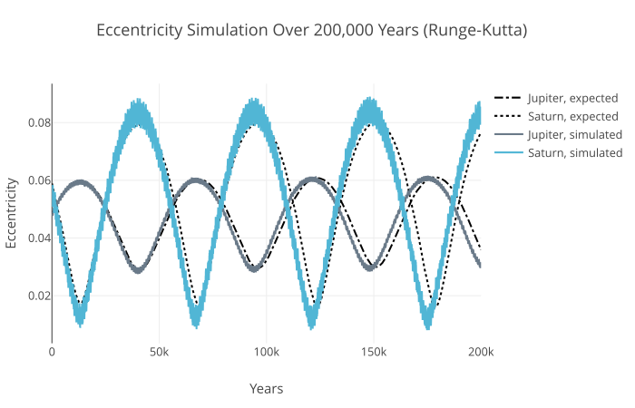
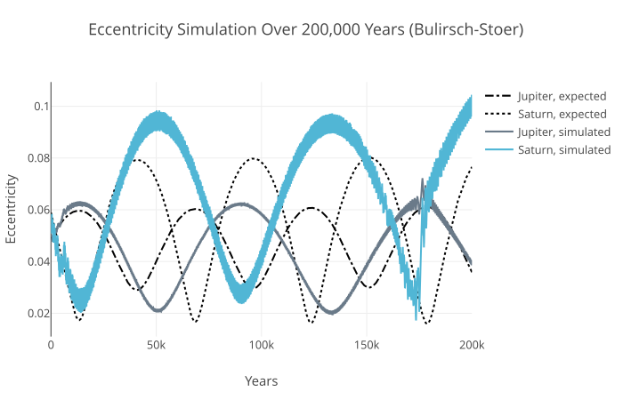

# Bulirsch-Stoer Instability in ORSA with Java Plotly Visualisation

This repository holds digital resources associated with the article
"Bulirsch-Stoer Instability in ORSA with Java Plotly Visualisation"
[[1](#references)]. That article discusses numerical instability of the
Bulirsch-Stoer algorithm, as implemented in the legacy GUI application Orbit
Reconstruction, Simulation and Analysis (ORSA). The instability was
demonstrated with Plotly visualisation tools, called from Java.

 
<table>
<tr>
<td>
<figure>
  

  <picture><source media="(prefers-color-scheme: dark)" srcset="assets/eccentricity-simulation-with-runge-kutta-dm.svg"></picture>
  <picture><source media="(prefers-color-scheme: dark)" srcset="assets/eccentricity-simulation-with-bulirsch-stoer-dm.svg"></picture>
  

  <figcaption>Figure 1. Eccentricity variation of Jupiter (low amplitude) and Saturn (high amplitude) over 200,000 years, from Runge-Kutta (plot 1) and Bulirsch-Stoer (plot 2) integration in legacy ORSA. Analytical estimates are the dotted lines. Runge-Kutta generally matches estimates. Bulirsch-Stoer diverges.</figcaption>
</figure>
</tr>
</table>

## Table of Contents

- [Key Files](#key-files)
- [Software Requirements](#software-requirements)
- [Getting Started](#getting-started)
- [Quality Assurance](#quality-assurance)
- [Acknowledgements](#acknowledgements)
- [References](#references)
- [Citation](#citation)
- [License](#license)

## Key Files

| File                                        | Notes                     |
| :------------------------------------------ | :------------------------ |
| `src/main/java/EccentricitySimulation.java` | Java program.             |
| `src/main/resources/orsa-output.csv`        | Planetary data.           |
| `pom.xml`                                   | Maven configuration file. |

`EccentricitySimulation.java` is a Java program for visualising planetary
orbital element variation with the Tablesaw wrapper for Plotly.

`orsa-output.csv` holds Jovian and Saturnian eccentricity and inclination
evolution data. Some data were calculated via analytical means, and some
simulated using Runge-Kutta and Bulirsch-Stoer integration in ORSA.

## Software Requirements

| Software               | Notes                                                                                                       |
| :--------------------- | :---------------------------------------------------------------------------------------------------------- |
| Apache Maven &nbsp; | Build automation tool. &nbsp;&nbsp;&nbsp;[Available here](https://maven.apache.org/). Free.              |
| Browser                | Program output is HTML files.                                                                               |
| Java &nbsp;         | Java Development Kit (JDK) 27+. &nbsp;&nbsp;&nbsp;N.B. A Java Runtime Environment alone is insufficient. |

## Getting Started

### Apache Maven

The repository assumes Maven is available. The currently installed version of
Maven can be checked from the command line:

    mvn -version

### Java

The repository assumes a Java Development Kit is available. That can be
confirmed by checking if a Java compiler responds to version queries from the
command line:

    javac -version

### JAR Build

The repository has been configured for a Maven build of a Java Archive (JAR)
with dependencies. The build should be triggered at the command line, from the
repository root:

    mvn clean package

### JAR Execution

To run the JAR from the command line, from the repository root:

    java -jar target/bulirsch-stoer-instability-jar-with-dependencies.jar

Interactive plots will then be generated and opened in the system's default
browser.

## Quality Assurance

The repository code was tested when the associated article [[1](#references)]
was released. It has since undergone further testing against newer releases of
supporting technologies. Details are given below.

Test Environment, Publication

 

| Type         | Component    | Version             |
| :----------- | :----------- | :------------------ |
| Software     | Apache Maven | -                   |
| &quot;       | Eclipse      | 2021-09             |
| &quot;       | Java         | Standard Edition 16 |
| Java Package | tablesaw-*   | 0.38.5              |

Test Environment, Post-Publication

 

| Type         | Component        | Version                                 |
| :----------- | :--------------- | :-------------------------------------- |
| Platform     | Operating system | Windows 11, 26H2 (OS Build 26300.10075) |
| Software     | Apache Maven     | 3.10.1                                  |
| &quot;       | Browser          | Microsoft Edge, 158.0.4370.33 (64-bit)  |
| &quot;       | Java             | JDK 27.0.1.1                            |
| Java Package | guava            | 33.7.2-jre                              |
| &quot;       | jackson-core     | 2.22.3                                  |
| &quot;       | jackson-databind | 2.22.3                                  |
| &quot;       | tablesaw-core    | 0.44.4                                  |
| &quot;       | tablesaw-jsplot  | 0.44.4                                  |

## Acknowledgements

This work was supported by the Australian Research Council Training Centre in
Data Analytics for Resources and Environments (project ICI9010031).

Google Gemini [[2](#references)] and Microsoft Copilot [[3](#references)] were
used as assistive tools for Java linting.

## References

1. T. N. Stenborg, "Bulirsch-Stoer Instability in ORSA with Java Plotly
   Visualisation", in _Astron. Data Anal. Softw. Syst. XXXI_, in Astronomical
   Society of the Pacific Conference Series, vol. 535, B. V. Hugo, R. Van
   Rooyen and O. M. Smirnov, Eds., 2024, pp. 459&ndash;462.\
   [View PDF](https://aspbooks.org/publications/535/459.pdf)
   &nbsp; [View at publisher](https://aspbooks.org/custom/publications/paper/535-0459.html)
   &nbsp; [SciX](https://scixplorer.org/abs/2024ASPC..535..459S/abstract)

2. _Google Gemini_. (Large language model, September 2026 release). Google.
   [Online]. Available: [google.com](https://www.google.com/).

3. _Microsoft Copilot_. (2026). Microsoft. Accessed: 21&ndash;22 November 2026.
   [AI model output, Microsoft Copilot application (cloud‑based service)]
   Available:
   [Download the Microsoft Copilot app](https://www.microsoft.com/en-us/copilot/download-copilot-app).

## Citation

Citation details are available by clicking **Cite this repository** in the
GitHub sidebar.

## License

This repository is licensed under the BSD-3-Clause license. Details are
available in the [LICENSE](./LICENSE) file.
